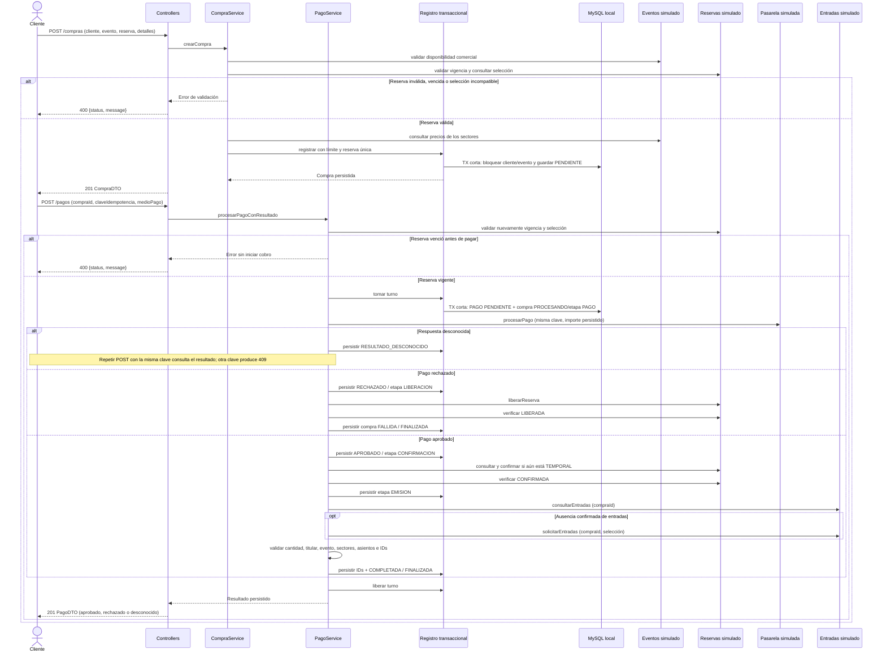
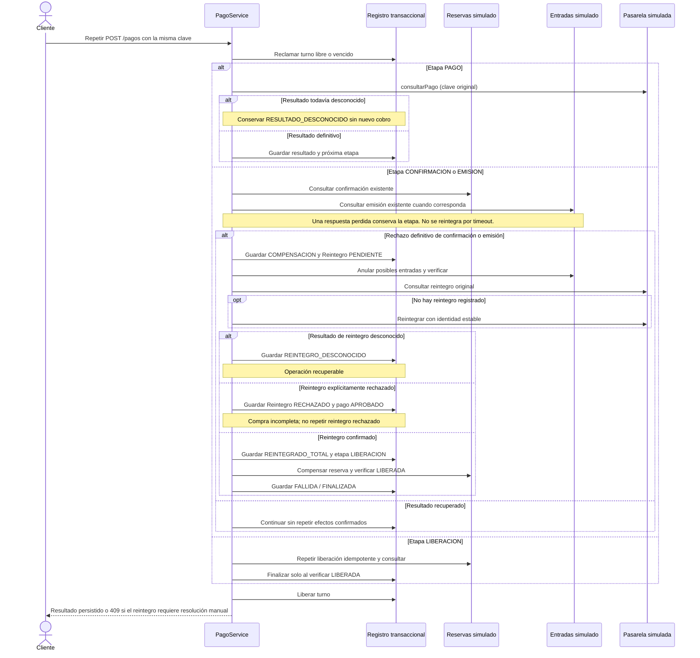
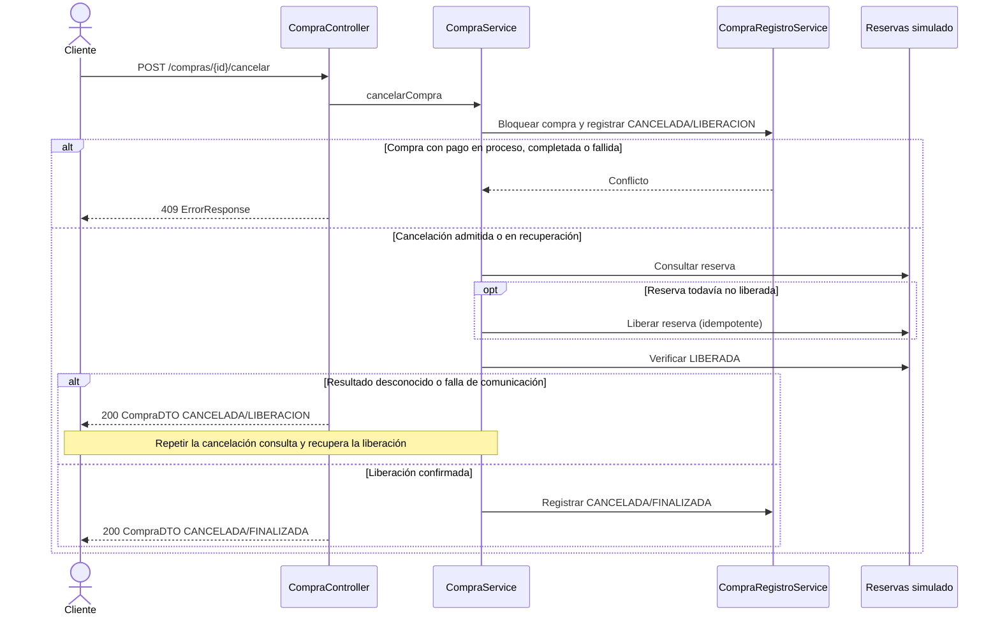
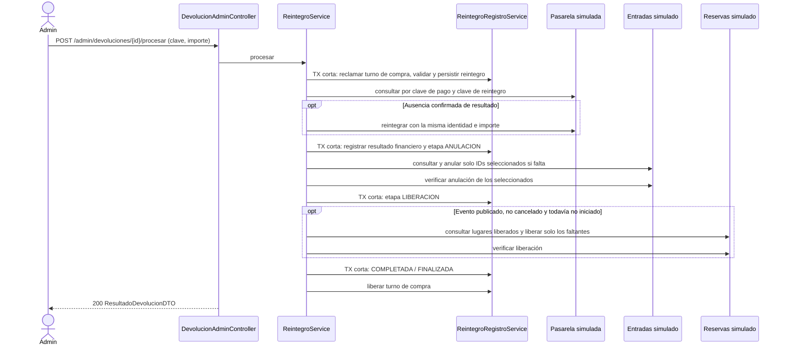

# Flujos de compra, pago y devoluciones (secciones 1–6)

> **Documento histórico: secciones 1–6 previas a la integración.** Se conserva como antecedente de diseño y pruebas locales. La versión actual tiene API Gateway y clientes REST de Eventos, Inventario y Entradas en el perfil `integracion`; la pasarela financiera sigue simulada. Consultar [arquitectura vigente](../../../docs/entrega1/arquitectura.md), [secuencias](../../../docs/entrega1/secuencias.md), [contratos](../../../docs/entrega1/openapi/README.md) y [pruebas registradas](../../../docs/entrega1/pruebas.md). Los pendientes y ejemplos de simuladores que siguen pertenecen a ese corte histórico.

El corte histórico aquí descrito utilizaba Eventos, Reservas, Entradas y pasarela simulados.
En ese corte todavía no estaban integrados REST ni Gateway. La sección 6 incorporaba devoluciones
voluntarias y notificaciones administrativas simuladas de cancelación de eventos.

## Compra exitosa, rechazo y vencimiento



Los errores de formato o validación son 400; recurso inexistente, 404; conflicto de
estado, reserva ya asociada o clave incompatible, 409. Un rechazo comercial de
la pasarela se representa en el PagoDTO, no como error de transporte.
El primer POST que registra el pago devuelve 201 incluso si queda pendiente;
los POST de recuperación o repetición devuelven 200. Consultar un GET no ejecuta recuperación.

## Recuperación y compensación



## Contratos internos

- El catálogo simulado reconoce eventos publicados 20, 21, 40 y 200. El 901 no está
  publicado, el 902 está cancelado y el 903 finalizado; los desconocidos se rechazan.
  Los sectores válidos son 1, 2 y 3, comparados como Long sin truncamiento.
- Los errores HTTP, incluidos 406 y 500, utilizan JSON con status y message. Un 500
  no expone detalles internos; para un Accept incompatible se conserva 406 y el error JSON.

- ReservaDTO incluye selección completa. Se comparan cantidades agrupadas por
  sector/asiento. Un asiento identificado admite exactamente una entrada y no se repite.
- La reserva se asocia a una sola compra mediante restricción única. Repetir la
  creación produce 409; para recuperar un pago se reutilizan compra y clave originales.
- Confirmar una reserva ya confirmada es idempotente. La compensación de una
  compra fallida puede liberar una confirmada; no es un caso de devolución.
- Emisión y consulta se identifican por compraId. Lista vacía significa ausencia
  confirmada; null o excepción significa incertidumbre. Repetir con otra selección
  produce conflicto.
- Anular una compra sin entradas registra igualmente una barrera durable: una
  solicitud de emisión demorada no puede emitir después de la compensación.
- Solo OperacionExternaRechazadaException indica rechazo definitivo sin efecto.
  Cualquier otra excepción conserva la etapa para verificar posteriormente.
- La pasarela identifica el cobro y su compensación total por la clave del pago.
  Reutilizarla con otro importe produce conflicto. Los reintegros voluntarios se
  procesan separadamente por /admin/devoluciones/{id}/procesar, con su propia clave.
- Un reintegro explícitamente rechazado se registra como RECHAZADO con fecha de
  procesamiento. El pago sigue APROBADO (cobrado), el importe reintegrado no aumenta
  y la compra continúa PROCESANDO/COMPENSACION. La solicitud devuelve 409 y señala
  resolución manual; las repeticiones tampoco reenvían el reintegro ni liberan la
  reserva como si se hubiera devuelto el dinero. Un rechazo financiero definitivo
  requiere intervención operativa; no se implementan nuevos intentos administrativos.
- RESULTADO_DESCONOCIDO sin resultado consultable nunca inicia otro cobro.
  Un PENDIENTE abandonado antes de obtener respuesta puede reenviar exclusivamente
  la misma operación idempotente, después de consultar el diario.

## Transacciones y concurrencia

CompraRegistroService aplica READ_COMMITTED y bloqueo por cliente/evento antes
de comprobar cupo y persistir. Cierra pendientes cuyo vencimiento registrado ya
pasó al evaluar una nueva compra del mismo cliente/evento. Las compras en
PROCESANDO siguen consumiendo cupo hasta resolver sus efectos. Política aprobada:
se descuentan entradas con reintegro confirmado, incluso si su anulación/liberación
sigue pendiente. Una devolución pendiente, aprobada, rechazada o con reintegro incierto
no devuelve cupo. Una devolución repetida no se descuenta dos veces. Las compras
DEVUELTA_TOTAL quedan excluidas; no se alteran sus detalles históricos ni el stock.

PagoRegistroService usa transacciones REQUIRES_NEW cortas y bloqueo por compra.
La compra conserva ejecutor y bloqueoHasta (dos minutos), renovados al persistir
cada etapa. Otra solicitud recibe 409 mientras el turno está vigente. Tras una
caída, se puede recuperar al vencer el turno. Un token reemplazado no puede
persistir resultados de un ejecutor anterior.

Las llamadas externas no ocurren dentro de estas transacciones. Su idempotencia
es necesaria incluso si un ejecutor se demora más que el turno y otro lo recupera.

Los simuladores de esta entrega usan operaciones_simuladas, sin claves foráneas al
dominio local y con transacciones propias, para conservar resultados tras reinicios.
Esto modela efectos externos que no se revierten con la transacción de Compras;
no es una integración ni una base compartida con servicios reales.

La recuperación es controlada por repetición del POST, sin scheduler ni mensajería.
Los contratos REST futuros deberán conservar las garantías aquí descritas.

## Cancelación de compra pendiente

POST /compras/{id}/cancelar registra primero CANCELADA/LIBERACION bajo el mismo
bloqueo de compra que usa el pago. Solo admite PENDIENTE o una cancelación ya iniciada;
PROCESANDO, COMPLETADA y FALLIDA producen 409. No cancela eventos ni devuelve pagos.



Una cancelación finalizada se devuelve sin nuevas llamadas externas. Si el pago
reclamó primero la compra, la cancelación se rechaza; si la cancelación se registró
primero, el pago se rechaza sin cobrar. La intención durable impide pagos incluso
si el servidor cae antes de liberar la reserva.

## Devolución aprobada y recuperación (6.5–6.9)

Cada devolución reintegra **todo** el importe histórico autorizado de sus entradas.
Una devolución parcial de la compra selecciona menos entradas; no divide monetariamente
una solicitud. Después de una devolución parcial se pueden solicitar las entradas restantes,
si se cumplen las 72 horas y las demás condiciones originales.



El diagrama muestra el caso exitoso. Ante comunicación fallida se registra
ERROR_PENDIENTE, se conserva la etapa y se libera el turno antes de responder 503.
GET de procesamiento permite consultar el avance. Repetir el POST con **la misma
clave e importe** consulta el resultado y continúa desde lo pendiente. Un resultado
financiero desconocido no habilita otra identidad de reintegro ni anulaciones.
Un rechazo financiero definitivo devuelve 409 y requiere resolución administrativa;
no se reenvía automáticamente. Los rechazos financieros no se resuelven con este endpoint.

El turno existente de Compra vence a los dos minutos; permite recuperar una caída
sin mantener una transacción abierta durante llamadas externas. El ejecutor anterior
no puede actualizar el registro con un token reemplazado. El diario simulado persiste
los efectos por separado y permite reconstruir los clientes sin perder idempotencia.

## API de devoluciones y ejemplos para Swagger

Swagger UI: `/swagger-ui/index.html`; contrato: `/v3/api-docs`.

| Método | Ruta | Uso |
|---|---|---|
| POST | `/devoluciones` | Solicitar; 201 y cabecera Location |
| GET | `/devoluciones/{id}` | Consultar solicitud |
| GET | `/admin/devoluciones?estado=PENDIENTE` | Filtrar solicitudes |
| POST | `/admin/devoluciones/{id}/aprobar` | Aprobar sin ejecutar efectos |
| POST | `/admin/devoluciones/{id}/rechazar` | Rechazar con motivo |
| POST | `/admin/devoluciones/{id}/procesar` | Reintegrar y coordinar o recuperar |
| GET | `/admin/devoluciones/{id}/procesamiento` | Consultar etapa y reintegro |
| GET | `/admin/reintegros/{id}` | Consultar resultado financiero |
| POST | `/admin/eventos/{id}/cancelacion` | Recibir/reintentar cancelación simulada |

Usar IDs reales obtenidos de POST /compras y de su pago completado. Por ejemplo,
para compra 1 del cliente 10, entrada 100001 y precio histórico 15000:

Solicitud en POST /devoluciones:
```json
{"compraId":1,"clienteId":10,"entradasIds":[100001],"motivo":"No puedo asistir"}
```

Aprobación (o rechazo) sobre el ID de devolución devuelto:
```json
{"motivo":"Solicitud revisada por administracion"}
```

Procesamiento sobre el mismo ID:
```json
{"claveIdempotencia":"devolucion-1","importe":15000.00}
```

Repetir el último cuerpo permite recuperar el proceso. Importe distinto de la
autorización: 400; clave reutilizada con datos incompatibles, otra clave para la
misma devolución o turno ocupado: 409. Validaciones: 400; recursos ausentes: 404;
fallo de comunicación: 503. Los errores usan ErrorResponse; las respuestas de
negocio son DTO y no contienen entidades JPA. Todos los plazos y fechas son UTC.

## Cancelación de evento e integración futura

POST /admin/eventos/20/cancelacion no necesita cuerpo. Es una **notificación
administrativa autoritativa simulada**, no un cliente REST real de Eventos.
Primero persiste el evento simulado cancelado, bloqueando nuevas validaciones
comerciales. Conserva rechazos como historial, aprueba automáticamente las solicitudes
pendientes y recupera las aprobadas o en proceso con su misma clave. Solo crea
solicitudes para entradas restantes; no aplica las 72 horas. Las entradas se anulan
sin reofrecer sus lugares. Las devoluciones voluntarias anteriores quedan registradas.

Cada compra se procesa independientemente: un fallo no impide las demás. Responde
200 si finalizó y 202 con comprasPendientes si requiere recuperación. Repetir la
notificación recupera esas compras sin duplicar reintegros. Las compras aún sin pago
reutilizan la cancelación de compra existente; las que tienen un pago PROCESANDO
se reportan pendientes: resolver primero POST /pagos con su clave original y luego
repetir la notificación. No se supone atomicidad entre una compra en curso y el aviso.
La entrega utiliza recuperación controlada, sin tareas automáticas ni mensajería.

Contratos que deben acordarse antes de integrar servicios reales:

- Eventos: notificación autoritativa e idempotente de cancelación y disponibilidad/fecha UTC.
  Debe impedir ventas posteriores y asegurar la entrega/repetición del aviso ante compras concurrentes.
- Entradas: anulación por compra e IDs seleccionados, consulta del estado y prohibición de reemisión;
  sus IDs y sector/asiento deben corresponder a la compra y sus detalles históricos.
- Reservas: liberación parcial con identidad estable por entrada y consulta de liberaciones;
  validar la selección original y condicionar atómicamente la disponibilidad al estado del evento.
  La liberación de una reserva temporal es distinta de reofrecer entradas ya vendidas.
- Pasarela: clave independiente del pago, importe compatible, consulta autoritativa del resultado
  y tope agregado por pago. Una consulta no disponible no equivale a ausencia de operación.
- Seguridad futura: todas las rutas /admin requieren autorización administrativa; las solicitudes
  y consultas de cliente deben comprobar la identidad autenticada y su titularidad. **Esta entrega
  no implementa autenticación ni autorización**: el prefijo y clienteId no son controles de acceso.

Antes de iniciar contra una base histórica, revisar el esquema y los estados pendientes.
El procedimiento de migración manual de medio_pago y su verificación se centralizan
en modelo-entidades.md. No hay migración automática al iniciar; durante la preparación
del script no se ejecutaron operaciones sobre bases de datos.

## Medio de pago y compatibilidad de POST /pagos

El contrato agrega medioPago: TARJETA_CREDITO, TARJETA_DEBITO, TRANSFERENCIA o
BILLETERA_VIRTUAL. Para nuevos pagos es obligatorio; ausencia/null, valores vacíos,
desconocidos, numéricos u objetos producen 400 sin registrar ni cobrar. Se valida
antes de efectos externos y nuevamente bajo bloqueo local. Es una clasificación
comercial, no información bancaria. La pasarela simulada conserva su aprobación por
importe y sus interfaces actuales; el medio se registra localmente antes de cobrar.

```json
{"compraId":1,"claveIdempotencia":"pago-compra-1","medioPago":"TARJETA_DEBITO"}
```

PagoDTO agrega medioPago a la respuesta de procesamiento y consultas. Ejemplo
ilustrativo de un resultado aprobado, sin reintegros:

```json
{"id":1,"compraId":1,"claveIdempotencia":"pago-compra-1","importe":30000.00,"importeReintegrado":0.00,"estado":"APROBADO","fechaCreacion":"2026-11-07T12:00:00","fechaProcesamiento":"2026-11-07T12:00:01","referenciaExterna":"referencia-simulada","referenciaReintegro":null,"medioPago":"TARJETA_DEBITO"}
```

Repetir compra, clave y medio conserva la operación, sus referencias y resultado,
sin cobrar otra vez. Otro medio con la misma clave produce 409; omitir el medio
registrado produce 400. Esta verificación se aplica también a pagos inciertos o
finalizados. Se mantienen 201 para intentos nuevos y 200 para repeticiones; un 201
no significa necesariamente aprobación, sino registro del intento.

Los pagos históricos sin dato conservan medioPago null en consultas y recuperación.
Para recuperar exclusivamente esos pagos se permite omitirlo con compra y clave
originales; informar un medio produce 409 y no completa retroactivamente el dato.
La omisión no permite iniciar pagos nuevos. No se borran ni reinicializan históricos
para incorporar la columna; revisar modelo-entidades.md antes de iniciar sobre ellos.

## Pendientes para acordar con el grupo: sección 7

En el corte histórico, los puntos siguientes figuraban **PENDIENTES DE INTEGRACIÓN**; no describen el estado vigente. Son preguntas y
requisitos de compatibilidad de las interfaces actuales, no endpoints externos acordados:

| Servicio | Acuerdo necesario antes de reemplazar el simulador |
|---|---|
| Eventos | IDs Long, precios positivos de dos decimales y fecha UTC. Distinguir PUBLICADO, AGOTADO, SUSPENDIDO y CANCELADO: eventoValido hoy solo acepta publicados. No confundir agotado con prohibición de liberar un lugar devuelto; acordar política de reapertura y fecha modificada. |
| Eventos/cancelaciones | registrarCancelacion hoy recibe una notificación administrativa simulada. Acordar emisor, identidad/repetición del aviso, consulta del estado y compras concurrentes; no convertir automáticamente este comando en una modificación REST del catálogo. |
| Reservas | Titular, evento, selección completa, vencimiento y consulta autoritativa. Acordar el resultado de confirmar al vencer, quién libera al expirar y la exclusión de venta del mismo asiento o último cupo, incluso con varias instancias. |
| Reservas/liberación | Distinguir liberar reserva temporal, compensar confirmación de compra fallida y liberar parcialmente entradas reintegradas. Preservar identidad por entrada y no aumentar dos veces disponibilidad; condicionar la reapertura al estado del evento. |
| Entradas | Emitir por compra y selección, consultar antes de repetir y anular por IDs. Acordar QR, estados, identidad, barrera contra reemisión y asociación con detalle histórico; varios precios del mismo sector/asiento hoy producen rechazo por ambigüedad. |
| Pasarela | Conservar clave+importe, consulta y tope agregado; el medio se registra en Compras. Acordar cualquier mapeo externo posterior, sin transmitir credenciales en DTO. El reintegro tiene clave propia e importe completo por solicitud. |
| Todos | Distinguir rechazo definitivo sin efecto, ausencia confirmada y resultado incierto. Fijar timeouts y traducción de errores; consultar y reintentar con identidad estable. Un timeout no habilita compensación automática ni otra identidad. |
| Gateway | Rutas públicas e identificación de usuario por parámetro/encabezado para Entrega 1; errores y respuestas incompletas. JWT/roles corresponden a Entrega 2. |

La devolución aprobada requiere un POST de procesamiento separado. Los reintegros
rechazados requieren resolución operativa manual; no se agregó un nuevo circuito
financiero. La prueba global de no doble venta debe realizarse con el inventario
real; los tests locales del límite o de idempotencia no la reemplazan.

## Inventario documental para Entrega 1

| Documento exigido | Responsabilidad | Estado y dependencia |
|---|---|---|
| Features y User Stories de todo TicketYa | Compartida del grupo | Pendiente. Se puede partir del enunciado; verificar estados con cada integrante. No se genera en esta etapa. |
| Diagrama general de módulos | Compartida; depende de arquitectura integrada | Pendiente. No hay diagrama global definitivo. |
| Secuencia numerada, rechazo y vencimiento | Compartida con aporte propio | Hay secuencia local genérica y alternativas; falta completar selección numerada, inventario y vencimiento con Reservas/Entradas. |
| DER y relaciones externas | Propia por servicio y consolidación compartida | DER local actualizado. Pendientes los otros DER, propietarios de referencias y entidades solapadas. |
| Catálogo REST con parámetros, respuestas y JSON | Propia; consolidación tras integración | Hay rutas y ejemplos parciales, incluido medioPago. Falta catálogo exhaustivo y contratos externos acordados. |
| OpenAPI/Swagger completo | Propia y compartida | Contratos locales publicados; medioPago actualizado. Pendientes pulido global, ejemplos exhaustivos y revisión por endpoint. |
| README de ejecución | Propia y compartida | Pendiente; no se genera el definitivo. Acordar arranque, bases, variables y rutas tras integrar. |
| Documentación técnica adicional | Propia | Modelo, flujos y pruebas presentes. Se identifican cortes históricos y pendientes actuales. |
| Datos de prueba reproducibles | Propia y compartida; requiere contratos para escenarios globales | Fixtures de tests/simuladores disponibles. Falta conjunto reproducible por API para rechazo, asiento numerado y stock compartido. |
| Colección Postman o equivalente | Propia y compartida; rutas definitivas tras integrar | Pendiente. No se genera colección definitiva. |
| Especificaciones OpenSpec versionadas | Propia y compartida | Propuesta, diseño, tareas y cuatro capacidades locales. Se actualizan medio y límite; sección 7 permanece pendiente. |

La documentación definitiva y los diagramas globales se completarán con el grupo.
El documento auxiliar de 6.1–6.4 conserva su condición sin seguimiento y no se agrega
al entregable Git en esta etapa. Los informes de cortes anteriores son históricos,
no la fuente del estado actual de secciones 1–6.
