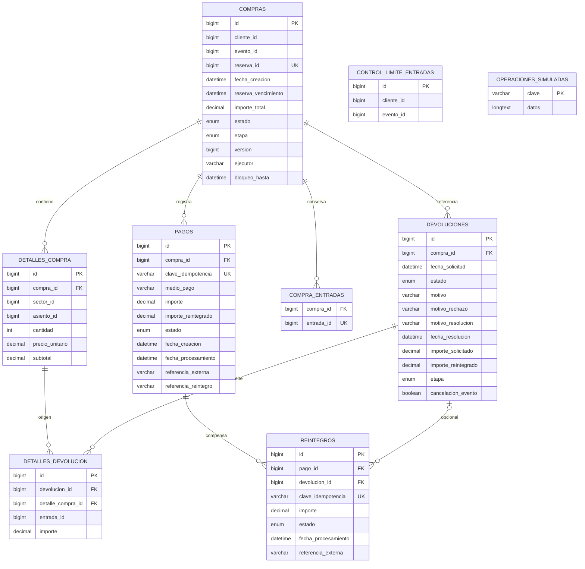

# Modelo entidad-relación — Compras y Pagos

Hay ocho entidades JPA y una tabla adicional de colección de identificadores de entradas.
La sección 6 implementa solicitudes, decisiones, reintegros y coordinación recuperable
de anulaciones, liberaciones y cancelaciones de eventos mediante clientes simulados.



## Restricciones y relaciones

- Todos los IDs de entidades de dominio se generan con IDENTITY; operaciones_simuladas
  tiene clave textual asignada por tipo e identidad de operación.
- Todos los importes del dominio usan DECIMAL(12,2). Cantidades y precios se validan
  antes del registro; los precios externos deben ser positivos y representables sin redondear.
- Compra tiene @Version, reserva_id NOT NULL UNIQUE y detalles con cascade ALL/orphanRemoval.
- Compra conserva etapa, turno temporal y vencimiento conocido de la reserva. Estado y etapa
  son NOT NULL. Los IDs emitidos se conservan en compra_entradas y entrada_id es único.
- ControlLimiteEntradas tiene UNIQUE(cliente_id, evento_id); no es una relación JPA con Cliente
  ni Evento. Su fila permite serializar la evaluación del límite.
- Pago tiene compra_id obligatorio y clave de idempotencia NOT NULL UNIQUE.
  La API limita esa clave a 100 caracteres. Una compra finalizada no inicia otro intento.
- Pago incorpora medio_pago como enum por nombre: TARJETA_CREDITO, TARJETA_DEBITO,
  TRANSFERENCIA y BILLETERA_VIRTUAL. Es obligatorio para nuevos pagos y parte de su
  identidad idempotente. La columna admite null para históricos sin información;
  no tiene valor comercial por defecto ni backfill automático. No se almacenan datos bancarios.
- El límite por cliente/evento conserva cantidades históricas pero descuenta entradas
  distintas con reintegro COMPLETADO. Ni la solicitud, aprobación, rechazo ni un
  resultado financiero desconocido liberan cupo. La anulación/liberación pendiente
  no impide descontar un reintegro ya confirmado. No se modifica el stock externo.
- Reintegro tiene pago_id obligatorio, devolucion_id opcional y clave NOT NULL UNIQUE.
  Las compensaciones técnicas conservan devolucion_id null y clave compensacion:{pagoId}.
  Las devoluciones de entradas vinculan el reintegro con la solicitud aprobada;
  cada solicitud autoriza un único importe completo y una clave estable.
  Varios reintegros parciales de un pago corresponden a selecciones disjuntas de entradas.
  El bloqueo de compra y el turno existente serializan su registro y procesamiento;
  el cálculo de saldo incluye operaciones completadas y de resultado aún desconocido.
- DetalleDevolucion requiere devolución, detalle original, entrada e importe.
  No tiene unicidad global de entrada: las solicitudes RECHAZADAS conservan su historial
  y permiten otra solicitud. Las tareas 6.1–6.4 serializan por compra y bloquean
  cualquier solicitud previa distinta de RECHAZADA para esa entrada.
- Devolucion conserva motivo del cliente, motivoResolucion y fechaResolucion de la
  decisión administrativa; motivoRechazo se mantiene para compatibilidad. Las columnas
  nuevas son opcionales para solicitudes pendientes e información histórica.
- Devolucion conserva etapa REINTEGRO → ANULACION → LIBERACION → FINALIZADA y
  cancelacionEvento. ERROR_PENDIENTE conserva la etapa, clave y resultado financiero;
  COMPLETADA exige confirmar todos los efectos aplicables. Una etapa null de las
  solicitudes antiguas de 6.1–6.4 se inicializa en REINTEGRO al comenzar.
- Reintegro conserva importe, clave, pago/devolución, estado y fecha/referencia del
  resultado conocido. Pago.importeReintegrado y Compra.DEVUELTA_PARCIAL/TOTAL reflejan
  los reintegros confirmados; no implican que la anulación/liberación haya finalizado.
- Los simuladores conservan un diario de reintegros por pago con tope agregado,
  entradas anuladas por ID y lugares liberados por ID de entrada. El diario externo
  no se revierte al fallar una transacción del dominio.
- Fecha de resultado y referencias externas pueden ser null mientras no haya resultado conocido.
  Las fechas del circuito de compra/pago y los vencimientos simulados se interpretan en UTC.
- Los enums validan transiciones en los setters de las entidades. Las transiciones del circuito
  son PENDIENTE → PROCESANDO → COMPLETADA o FALLIDA. No se permiten cambios arbitrarios.
- La cancelación pendiente usa PENDIENTE → CANCELADA y etapa LIBERACION hasta
  verificar la reserva; después conserva CANCELADA con etapa FINALIZADA.
- Un reintegro de compensación rechazado conserva el pago cobrado y la compra
  incompleta. Si antes era REINTEGRO_DESCONOCIDO, un rechazo confirmado devuelve
  el pago a APROBADO y registra el Reintegro RECHAZADO, sin aumentar importes.
- Las referencias externas son IDs: cliente, evento, reserva, sector, asiento y entrada.
  No hay relaciones JPA con tablas de otros microservicios.
- operaciones_simuladas es el diario auxiliar de los simuladores de esta entrega.
  No tiene FK con compras, pagos o reservas y utiliza transacciones independientes.

## Esquemas existentes

Las pruebas generan un esquema nuevo en un MySQL aislado. No se ejecuta ningún cambio
contra ticketya_compras durante la verificación.

El desarrollo conserva ddl-auto=update. Antes de iniciar esta versión sobre datos antiguos,
hay que revisar reservas duplicadas, compras con pagos ya aprobados que seguían PENDIENTE
y operaciones externas pendientes. Los nuevos campos de coordinación deben inicializarse
según esos resultados, no suponiendo que toda compra histórica está en etapa PAGO.
Esta entrega no ejecuta una migración ni reconciliación automática sobre datos anteriores.

### Migración manual de medio_pago (MySQL 8)

El script versionable `db/migrations/V001__agregar_medio_pago.sql` incorpora
`pagos.medio_pago VARCHAR(32) NULL` en bases existentes. Es manual: no está en
los recursos de inicialización de Spring ni se incorporó un framework de migraciones.
Consulta INFORMATION_SCHEMA en la base seleccionada; si la columna existe, no ejecuta
ALTER ni modifica su definición. La repetición secuencial es segura. No hace backfill,
no asigna un medio por defecto y no borra ni actualiza pagos históricos.

Según la verificación manual informada por el usuario, desarrollo ya tiene esa columna,
los históricos se conservaron y existe un respaldo previo de pagos. No es necesario
reaplicarla allí. El script no se ejecutó como parte de este cambio; tampoco se volvió
a inspeccionar la base. Las pruebas anteriores verifican la aplicación y registros
con medio null, no la ejecución de esta migración.

Antes de aplicarla en otra base:

- Confirmar servidor/base destino, tabla pagos existente y respaldo recuperable.
- Revisar `SHOW CREATE TABLE pagos` y registrar cantidad de filas e históricos sin medio
  cuando la columna ya exista. Si existe con otra definición, revisarla manualmente:
  el script no intenta corregirla ni convertirla.
- Detener la aplicación y coordinar una única ejecución de migración. ALTER TABLE puede
  esperar bloqueos de metadatos y produce commit implícito; ROLLBACK no deshace este DDL.
- Usar una cuenta autorizada para ALTER y SELECT, sin incluir contraseñas en el script.

Desde `TicketYa/comprapago_service`, abrir el cliente mysql con la base destino explícita
(reemplazar host, puerto, usuario y nombre de base según el entorno autorizado):

```text
mysql --host=127.0.0.1 --port=3306 --user=USUARIO --password --database=BASE_DESTINO
```

En esa misma sesión, comprobar el destino y ejecutar el archivo completo:

```sql
SELECT @@hostname AS servidor, @@port AS puerto, DATABASE() AS base_destino;
SELECT COUNT(*) AS pagos_antes FROM pagos;
SOURCE db/migrations/V001__agregar_medio_pago.sql;
SHOW COLUMNS FROM pagos LIKE 'medio_pago';
SELECT COUNT(*) AS pagos_despues,
       COALESCE(SUM(medio_pago IS NULL), 0) AS pagos_sin_medio
FROM pagos;
```

En Workbench puede seleccionarse el esquema destino y ejecutarse el contenido SQL
completo, sin usar el comando SOURCE del cliente mysql. No ejecutar solo una sentencia
aislada del bloque PREPARE/EXECUTE. Sin base seleccionada o sin tabla pagos, el script
falla en lugar de crear estructuras. No utilizar opciones que ignoren errores.

La consulta final del script muestra la definición. Para una columna creada por él se
espera `COLUMN_TYPE = varchar(32)`, `IS_NULLABLE = YES` y `COLUMN_DEFAULT = NULL`.
La cantidad de pagos debe conservarse; al agregar la columna, las filas anteriores
quedan con NULL. Al repetir sobre una columna existente, también deben conservarse
los medios ya registrados y los históricos NULL. No ejecutar aplicaciones/escrituras
concurrentes durante esa comparación. Conservar la salida y el respaldo; no se incluye
un rollback que elimine la columna, porque perdería medios registrados posteriormente.

**Coherencia con JPA:** Pago usa `@Enumerated(EnumType.STRING)` y
`@Column(name = "medio_pago", length = 32)` sin `nullable = false`; los cuatro nombres
de MedioPago caben en VARCHAR(32) y los históricos NULL son válidos. El DER refleja
la columna VARCHAR de esta migración; el enum es la clasificación Java. La anotación
no obliga a Hibernate a generar VARCHAR: el dialecto MySQL puede preferir ENUM nativo.
Con `ddl-auto=update` debe revisarse cualquier DDL propuesto antes del siguiente arranque;
este script no cambia el mapeo, configura Hibernate ni convierte una columna existente.

Referencias: [sentencias preparadas de MySQL 8](https://dev.mysql.com/doc/refman/8.0/en/sql-prepared-statements.html),
[commit implícito de DDL](https://dev.mysql.com/doc/refman/8.0/en/implicit-commit.html) y
[mapeo de enums en Hibernate](https://docs.hibernate.org/orm/7.1/introduction/html_single/).
