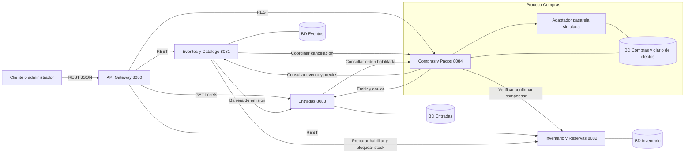

# Arquitectura implementada

TicketYa tiene cuatro aplicaciones propietarias de datos y un Gateway sin base de datos. Todas las comunicaciones entre dominios son REST/JSON síncronas. Las cuatro bases son relacionales; compartir MySQL local no implica compartir entidades ni transacciones.

[Fuente Mermaid](diagramas/arquitectura.mmd).

| Proyecto | Responsabilidad | Puerto normal | Esquema predeterminado |
|---|---|---|---|
| EventoCatalogo_Service | Lugares, sectores, asientos de catálogo, participantes, eventos, precios, búsqueda y coordinación de publicación/cancelación | 8081 | eventos_catalogo_DB |
| inventarioReserva_service | Stock por evento/sector, asientos operativos, reservas, expiración y diario de lugares devueltos | 8082 | db_inventario_reservas |
| comprapago_service | Compras, etapas durables, pagos, devolución y reintegro; orquestación de compensaciones | 8084 | ticketya_compras |
| entradas_service | Lotes por orden, entradas UUID/QR, estados y barreras durables de emisión | 8083 | ticketya_entradas |
| api-gateway | Reenvío HTTP de las rutas públicas | 8080 | Ninguno |

## Límites y llamadas

Eventos prepara Inventario sin habilitar reservas antes de publicar; para suspender/cerrar bloquea inventario. Para cancelar bloquea primero la emisión de Entradas, registra el estado y coordina Inventario y Compras. Compras consulta datos y precios de Eventos, verifica/confirmar/libera reservas en Inventario y solicita emisión/anulación a Entradas. Entradas consulta a Compras por una orden habilitada antes de emitir. No accede a sus tablas.

La pasarela simulada es un adaptador dentro de Compras, con efectos persistidos en `operaciones_simuladas`: no es un quinto microservicio ni una pasarela bancaria real. Aprueba hasta 100000 inclusive y rechaza montos superiores. Una clave `simular-timeout...` registra el efecto antes de simular la pérdida de respuesta.

## Rutas reales del Gateway

| Destino | Rutas publicadas |
|---|---|
| Eventos | `/api/v1/events/**`, `/api/v1/venues/**`, `/api/v1/sectors/**`, `/api/v1/participants/**` |
| Inventario | `/reservas`, `/reservas/{id}`, `/disponibilidad/**` |
| Entradas | GET `/tickets` |
| Compras | `/compras/**`, `/pagos/**`, `/devoluciones/**`, `/admin/**` |

No publica `/internal/**` en el entorno normal, ni los comandos directos de confirmación/liberación de reserva. La consulta de asientos del catálogo sí está accesible mediante Gateway aunque una anotación histórica la denomine interna. `/admin/eventos/{id}/cancelacion` también queda accesible por la regla real `/admin/**`; sirve para recuperar la coordinación, previa comprobación de `CANCELADO`. El inicio completo debe ser PATCH cancelar en Eventos.

## Consistencia y recuperación

Cada servicio usa transacciones locales. No hay transacción distribuida ni rollback atómico de los cinco proyectos. Compras persiste el camino exitoso `PAGO → CONFIRMACION → EMISION → FINALIZADA`, las etapas de recuperación `COMPENSACION` y `LIBERACION`, un turno de procesamiento de dos minutos e intención de cancelación. Hace REST fuera de sus transacciones cortas. Ante falla definitiva después del cobro compensa con anulación durable del lote, reintegro del cobro confirmado y compensación de la reserva. Un pago rechazado pasa a liberación sin reintegro ni solicitud de emisión. Ante incertidumbre mantiene progreso y permite repetir la misma solicitud con clave y medio originales. No existe worker de recuperación automática.

Inventario usa bloqueos de BD para evitar sobreventa incluso con dos instancias. La inicialización por evento/sector es idempotente si coincide la configuración y crea stock `PREPARADO`, no reservable. Eventos confirma `PUBLICADO` antes de llamar la habilitación comercial interna, que cambia todos los sectores a `HABILITADO` en una transacción. Si se interrumpe la preparación, permanece borrador y las reservas devuelven 409; si se interrumpe la habilitación, repetir publicar sobre PUBLICADO la recupera. Una inicialización incompatible se comunica como 422 permanente, separado del 503 temporal. Un control suspendido/cancelado rechaza habilitaciones tardías. Un PUBLICADO con habilitación pendiente puede aparecer en búsqueda, pero sus reservas siguen bloqueadas hasta recuperar esa coordinación. Las devoluciones registran identidades externas para no liberar dos veces el mismo lugar. La cancelación bloquea inventario, sin reofrecer lugares del evento.

Entradas conserva un lote único por orden, incluso cuando una anulación llegó antes que la emisión. `emission_event_gate` serializa en BD el commit de emisión y la cancelación por evento. La cancelación espera las emisiones previas y bloquea nuevas transacciones; no basta con consultar una vez el estado remoto. Una emisión previa a la barrera puede existir hasta que la coordinación la anule.

## Estados y perfiles

- Eventos: `BORRADOR`, `PUBLICADO`, `AGOTADO`, `SUSPENDIDO`, `CANCELADO`, `FINALIZADO`. Agotado/finalizado se asignan administrativamente; agotado puede reabrirse con cupo positivo. No hay reanudación pública del suspendido.
- Inventario: reserva `PENDIENTE`, `CONFIRMADA`, `LIBERADA`, `EXPIRADA`; el adaptador de Compras traduce pendiente como temporal. TTL normal 600 s, revisión cada 30000 ms.
- Compras: `PENDIENTE`, `PROCESANDO`, `COMPLETADA`, `FALLIDA`, `CANCELADA`. `CONFIRMADA` es una proyección del contrato interno de orden, no un estado persistido de Compra: exige etapa de emisión o compra completada y ausencia de cancelación solicitada.
- Entradas: `EMITIDA`, `ANULADA`, `REINTEGRADA`. La devolución ordinaria implementada anula las unidades reintegradas.
- `integracion` activa los adaptadores REST de Compras y es su perfil predeterminado. Sin él, existen simuladores de dominio para pruebas; no representan la arquitectura integrada. La pasarela de pagos continúa simulada en integración.
- `pruebas-integrales` agrega acreditación de aislamiento mediante token, esquema efectivo y destinos del Gateway. No es un perfil de demostración normal.

La búsqueda permite tipo, organizador, participante, ciudad exacta sin distinción de mayúsculas y fechas inclusivas. Ordena por fecha, precio mínimo o relevancia (`PUBLICADO`, fecha, ID). Devuelve una lista; no implementa filtro por nombre, paginación ni puntuación de texto.

Stack: Java 17 mínimo en Eventos/Inventario y Java 21 en Compras/Entradas/Gateway; usar JDK 21 para los cinco. Spring Boot 4.1.2, Spring Data JPA, MySQL; Gateway WebFlux y Spring Cloud 2025.1.4. Swagger dinámico usa Springdoc 3.2.0 donde está instalado. Entradas y Gateway cuentan con especificación estática en este paquete.

La identificación administrativa declarada usa `X-Admin-Id` positivo en las rutas `/admin/**` de Compras y en cancelar/suspender/status de Eventos. Eventos conserva además `X-User-Role: ADMIN` y traslada la identidad recibida al coordinar cancelación en Compras. No autentica ni verifica un usuario en una base de identidades: JWT y autorización efectiva quedan para E2.
