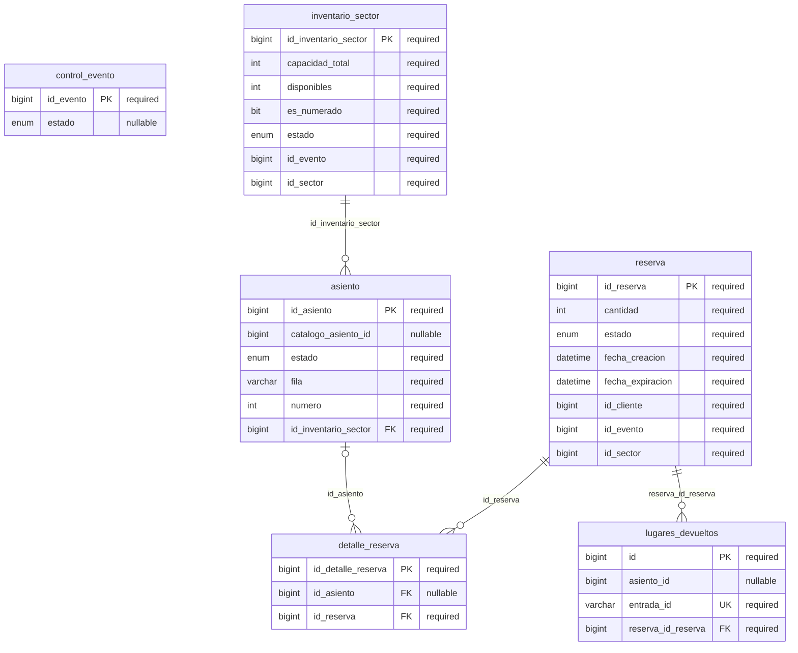
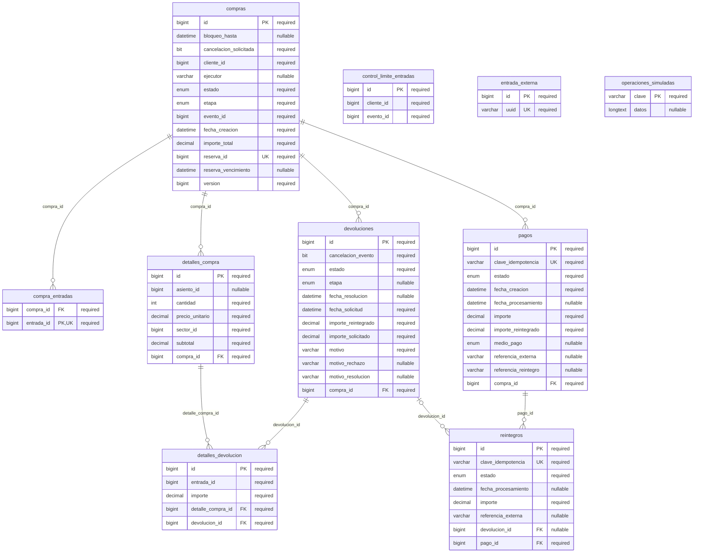
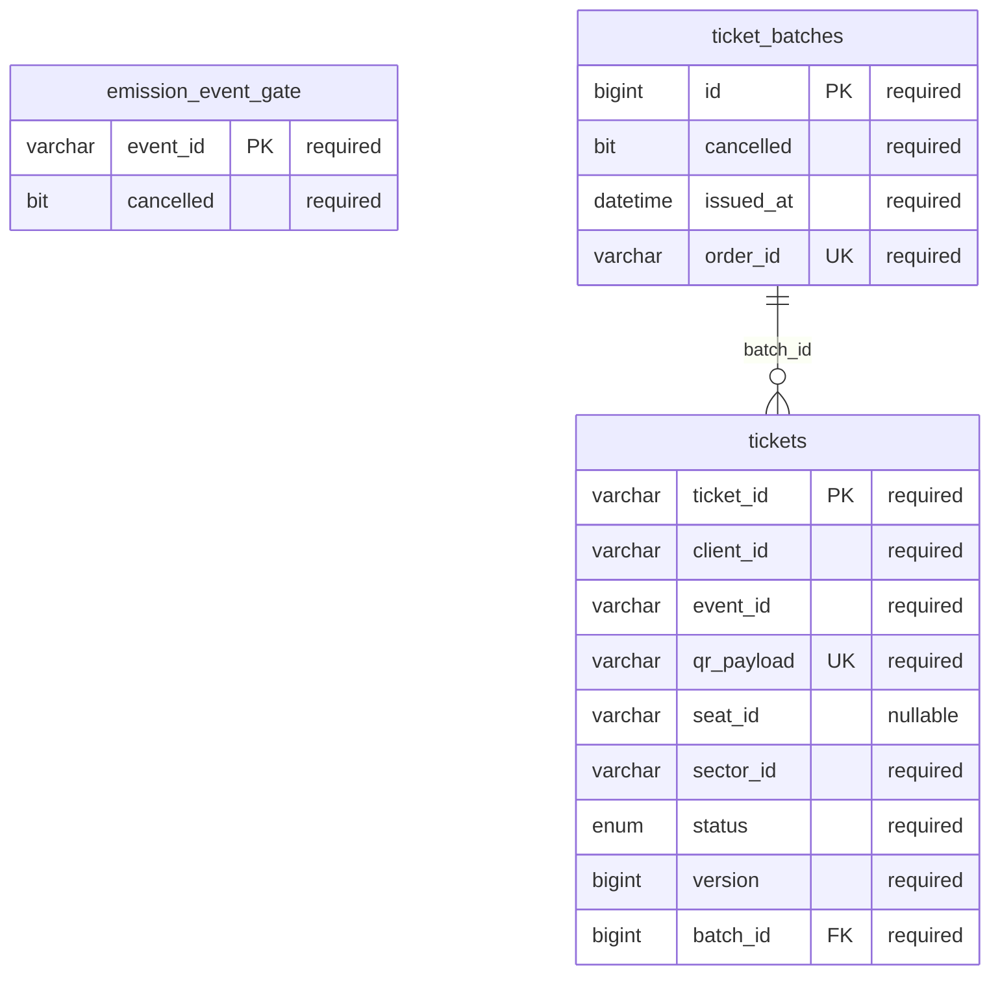

# Modelo relacional por microservicio

Los diagramas representan tablas y claves físicas del mapeo JPA actual. Los metadatos se consultaron en modo lectura en el MySQL aislado de la verificación previa; [snapshot](modelos/esquema-referencia.json). Cada esquema es propiedad de un servicio. No hay FK entre bases. `PK`, `FK` y `UK` indican claves; un UK compuesto se detalla como conjunto debajo y no como unicidad individual. Los tipos enum se simplifican a `enum` para Mermaid; su dominio literal permanece en el snapshot.

## Eventos

```mermaid
erDiagram
    event {
        bigint event_id PK "required"
        text description "nullable"
        varchar event_type "required"
        varchar name "required"
        bigint organizer_id "required"
        datetime start_date_time "required"
        enum status "required"
        bigint venue_id "required"
        bigint version "required"
    }
    event_participant {
        bigint event_id PK,FK "required"
        bigint participant_id PK,FK "required"
    }
    event_sector_price {
        bigint event_sector_price_id PK "required"
        decimal price "required"
        bigint sector_id "required"
        bigint event_id FK "required"
    }
    participant {
        bigint participant_id PK "required"
        varchar name "required"
        varchar role "nullable"
    }
    seat {
        bigint seat_id PK "required"
        varchar row_label "required"
        int seat_number "required"
        bigint sector_id FK "required"
    }
    sector {
        bigint sector_id PK "required"
        int capacity "required"
        datetime created_at "required"
        varchar name "required"
        enum type "required"
        bigint venue_id FK "required"
    }
    venue {
        bigint venue_id PK "required"
        varchar address "required"
        varchar city "nullable"
        datetime created_at "required"
        decimal latitude "required"
        decimal longitude "required"
        varchar name "required"
    }
    participant ||--o{ event_participant : "participant_id"
    event ||--o{ event_participant : "event_id"
    event ||--o{ event_sector_price : "event_id"
    sector ||--o{ seat : "sector_id"
    venue ||--o{ sector : "venue_id"
```

[Fuente Mermaid](diagramas/er-eventos.mmd).

Restricciones únicas compuestas (además de las claves individuales del gráfico):

- `event_participant`: `event_id, participant_id` (PK).
- `event_sector_price`: `event_id, sector_id` (UK).
- `seat`: `sector_id, row_label, seat_number` (UK).
- `sector`: `venue_id, name` (UK).

## Inventario

[Fuente Mermaid](diagramas/er-inventario.mmd).

Restricciones únicas compuestas (además de las claves individuales del gráfico):

- `inventario_sector`: `id_evento, id_sector` (UK).

## Compras

[Fuente Mermaid](diagramas/er-compras.mmd).

Restricciones únicas compuestas (además de las claves individuales del gráfico):

- `control_limite_entradas`: `cliente_id, evento_id` (UK).

## Entradas

[Fuente Mermaid](diagramas/er-entradas.mmd).

Restricciones únicas compuestas (además de las claves individuales del gráfico):

- No hay índices únicos compuestos en el snapshot.

## Identidades y relaciones lógicas

| Referencia | Correspondencia real |
|---|---|
| Evento y lugar | `event.venue_id` referencia lógica a `venue.venue_id`; no FK física, aun dentro de la misma base. |
| Precio y sector | `event_sector_price.sector_id` es referencia lógica; solo su relación con event tiene FK. |
| Asiento catálogo e inventario | `seat.seat_id` viaja como `catalogoAsientoId` al inicializar. Inventario asigna otro `asiento.id_asiento`. Reservar y comprar usa ese ID operativo; fila/número ayudan a presentarlo. |
| Compra y reserva | `compras.reserva_id` único apunta a Inventario por REST; no FK entre esquemas. |
| Compra y entrada | `entrada_externa.id` numérico local corresponde a UUID externo único. `CompraDTO.entradasIds` contiene los numéricos; `Ticket.ticketId` contiene UUID. |
| Colección de entradas | `compra_entradas.compra_id` tiene FK; `entrada_id` es valor numérico único de la colección, sin FK física a entrada_externa. |
| Ticket y orden | `ticket_batches.order_id` es string con ID de compra; ticket referencia físicamente a su lote. Los IDs de evento/cliente/sector/asiento son strings externos. |
| Gate de emisión | Identidad del evento externa a Entradas, sin FK a Eventos. |
| Lugar devuelto | Registro idempotente por entrada externa; referencias a reserva son internas, asiento_id es escalar. |

## Invariantes adicionales

- `control_limite_entradas` serializa el cupo por cliente/evento; pagos y reintegros guardan claves y efectos; `operaciones_simuladas` es el diario de la pasarela simulada.
- Precios e importes son decimales; no se calcula el reintegro con precios actuales del catálogo.
- El modelo de devolución separa solicitud, detalles por entrada y reintegro; aprobar no ejecuta el movimiento financiero.
- Bloqueos, transiciones y validaciones de selección complementan las restricciones SQL. Un DER no expresa por sí solo la prohibición de emitir después de cancelar.
- No se presupone igualdad numérica entre asientos de distintos servicios ni correspondencia posicional entre listas de entradas. GET /compras/{id}/entradas expone por unidad entradaId, ticketId UUID, sector, asiento y estado para seleccionar exactamente la devolucion.

## Entidades con información solapada

`seat` representa la grilla del lugar y `asiento` la disponibilidad operativa. `entrada_externa` proyecta el UUID y datos del ticket para asociarlo con detalles y devoluciones locales. Los detalles de compra conservan precios históricos del catálogo. No hay un segundo propietario del catálogo ni relaciones SQL entre servicios: se coordinan por REST.
