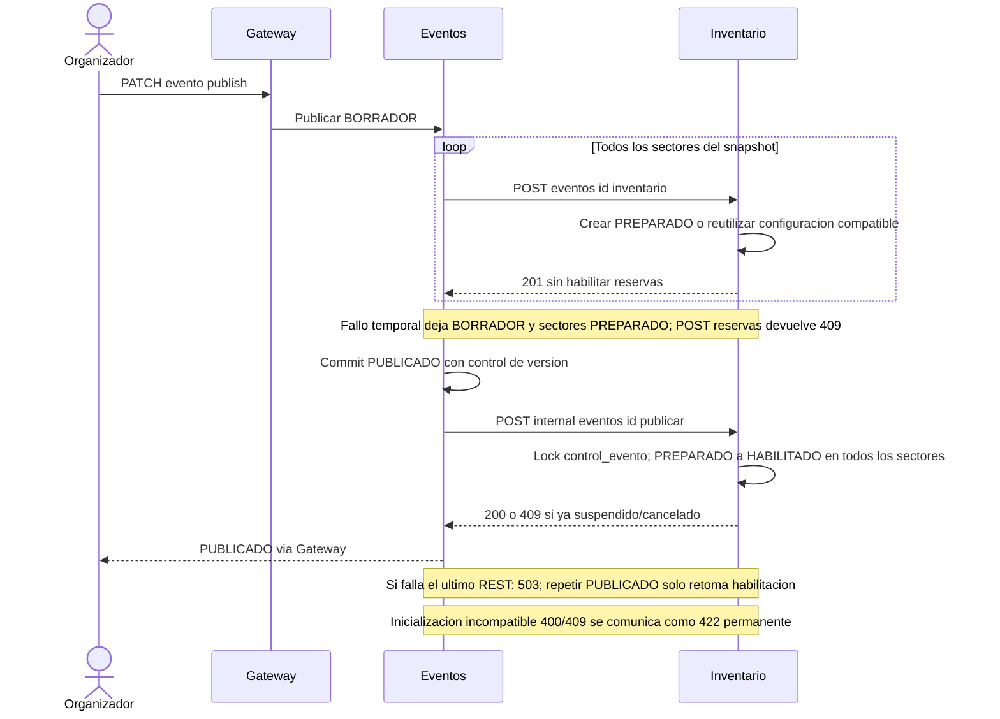
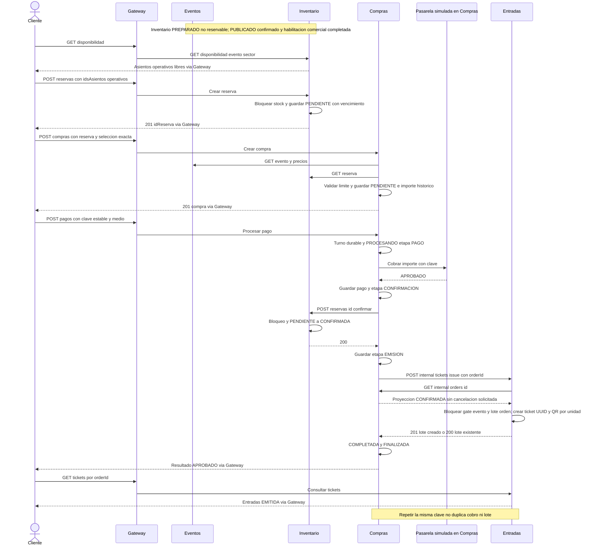
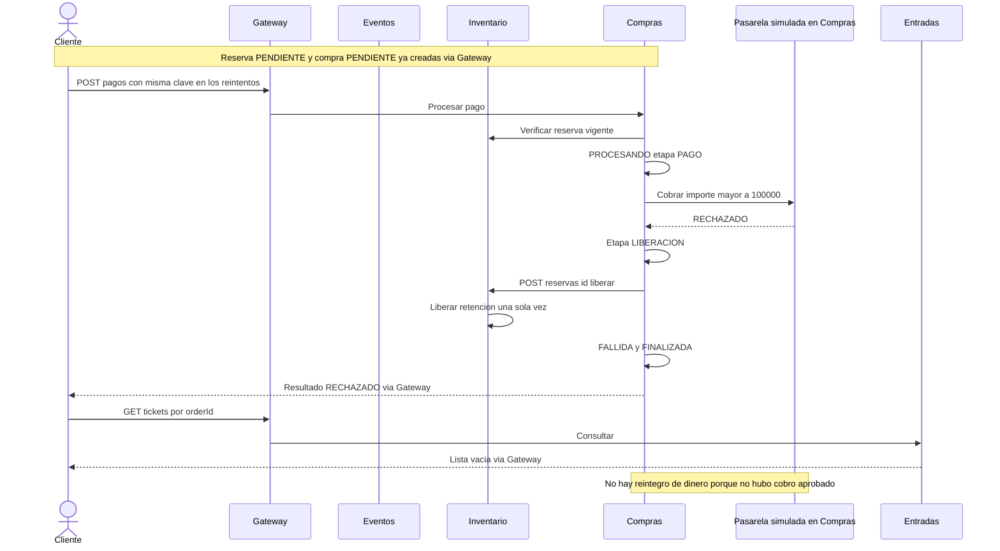
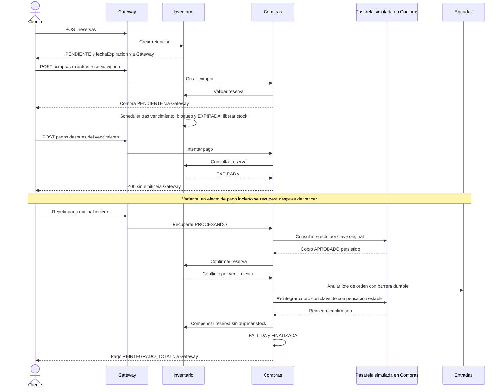
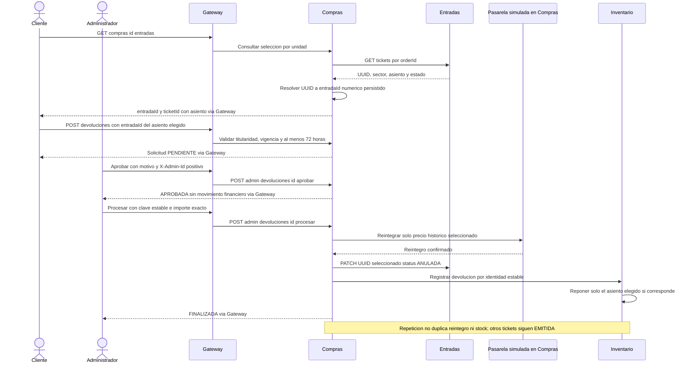
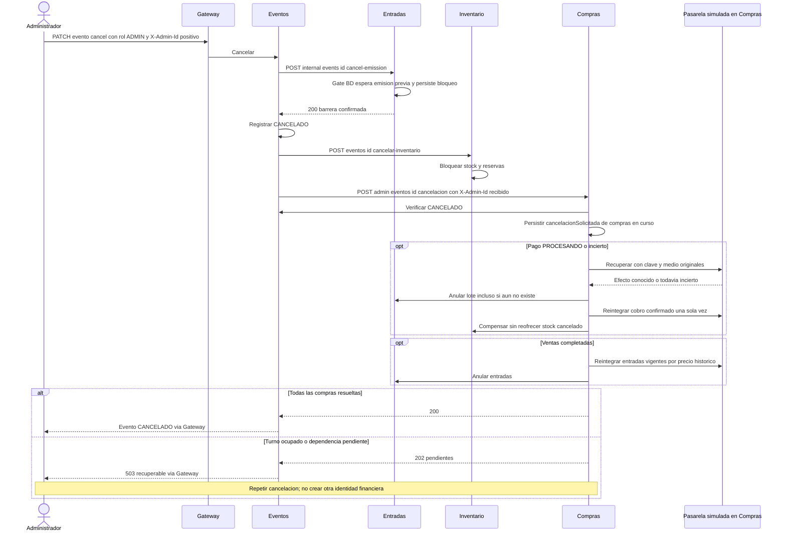

# Secuencias de Entrega 1

Las flechas REST de respuesta al cliente abrevían el retorno a través del Gateway. La pasarela es un adaptador del proceso Compras. Cada persistencia usa transacción local; los diagramas no implican atomicidad distribuida.

## Preparación y habilitación comercial recuperable

[Fuente Mermaid](diagramas/publicacion.mmd).

## Compra numerada con pago aprobado

[Fuente Mermaid](diagramas/compra-aprobada.mmd).

## Pago rechazado

[Fuente Mermaid](diagramas/pago-rechazado.mmd).

## Reserva que vence y variante con cobro incierto

[Fuente Mermaid](diagramas/reserva-vencida.mmd).

## Selección inequívoca y devolución parcial

[Fuente Mermaid](diagramas/devolucion-parcial.mmd).

## Cancelación con recuperación e impedimento de emisión tardía

[Fuente Mermaid](diagramas/cancelacion.mmd).

La variante de cobro incierto es un escenario alternativo: no continúa el intento rechazado antes de cobrar del primer bloque. Un 503 o timeout conserva efectos posibles; se consulta el resultado y se repite con las claves originales.
